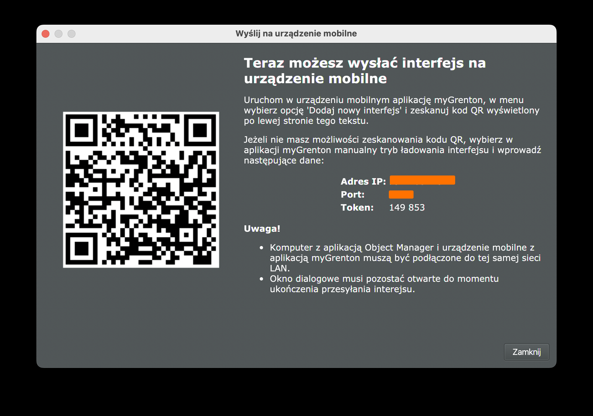

# Grenton Core for Swift

Control a Grenton smart home from Swift on macOS and iOS: lights, shutters,
thermostats, scenes and sensors, over the local network, the way the
myGrenton app does.

| | |
|---|---|
| **Local, no cloud** | Talks to the CLU controllers directly on your network, with their own encryption. |
| **Every device** | Switches, dimmers, RGB lights, shutters, thermostats, scenes, sensors and cameras. |
| **Always current** | CLUs push every change, so state stays up to date without polling. |
| **Conformance-tested** | Implements the Grenton Core specification and passes its conformance suite. |

This repository is the Swift implementation of **Grenton Core**, a portable
library for the Grenton smart-home "mobile interface" protocol. The
specification is language-agnostic and lives in
[grenton-core-spec](https://github.com/osieckiAdam/grenton-core-spec), together
with the conformance suite every port must pass. It covers provisioning (an
Object Manager client), the encrypted UDP runtime for CLU controllers and a
canonical device model, extracted from the
[homeassistant-grenton](https://github.com/sszczep/homeassistant-grenton)
integration.

## Documents

- [grenton-core-spec](https://github.com/osieckiAdam/grenton-core-spec): the language-agnostic specification and conformance suite. It is vendored at `vendor/grenton-core-spec` as a git submodule.
- [`docs/grenton-core-swift-port.md`](docs/grenton-core-swift-port.md) — Swift port plan (this repository)

## Modules

| Target | Status | Spec section |
|---|---|---|
| `GrentonModel` | done | §3 |
| `GrentonRuntime` | done (session, transports, state store) | §5 |
| `GrentonProvisioning` | done (Object Manager download, project-file import) | §4 |
| `GrentonDevices` | done (descriptors, entities, physical objects, `GrentonSystem` facade) | §6 |
| [`Examples/`](#examples) | small programs using the library | — |
| [Documentation](#documentation) | DocC reference and guides | — |
| [`grenton-cli`](#grenton-cli) | smoke tool for live installations | — |

## Quick start: try it against your installation

You need a Mac with Swift 6.0+ (Xcode 16+ or the Command Line Tools), and a
computer running Grenton Object Manager on the same LAN as the Mac and the CLUs.

```sh
git clone https://github.com/osieckiAdam/grenton-core-swift.git
cd grenton-core-swift
```

**1. Download the interface from Object Manager.** You need its IP address
and the PIN; see [Where to get the PIN and IP address](#where-to-get-the-pin-and-ip-address) below.

```sh
swift run fetch-interface 192.168.1.50 dist/interface.zip 149 853
```

There is no separate `swift build` step. `swift run` fetches the one
dependency (ZIPFoundation), compiles the package and starts the example. The
first run takes about 20 seconds, and later runs start almost immediately.

The saved file lets every next step run without a PIN. It contains the CLU
encryption key, so it is written readable by you only and `dist/` is
git-ignored.

No PIN at hand? The project file you save in Object Manager (`.omp`) holds
the same interface and key; `swift run import-project house.omp` reads it
and lists the devices. The other examples take the downloaded archive.

**2. List your devices.** This works offline, from the saved file alone.

```sh
swift run list-devices dist/interface.zip
```

```text
switch "Living room ceiling" — page SALON
  k3Xq9TzA_0: Living room ceiling
```

`k3Xq9TzA_0` is the entity id the next steps take. At the end you also see
the CLU objects shown by several widgets, such as a thermostat that appears
on two pages under two names.

**3. Watch the live state.** This is read-only.

```sh
swift run watch-state dist/interface.zip 30
```

It connects to the CLUs, prints every entity's current state, and then prints
each change for 30 seconds. Switch a light in the house to see one arrive.

On the first connection macOS asks whether the terminal may access devices on
the local network. Allow it, or nothing can reach the CLUs.

**4. Turn a light on and off.** This changes your house.

```sh
swift run switch-light dist/interface.zip k3Xq9TzA_0 on
swift run switch-light dist/interface.zip k3Xq9TzA_0 off
```

It works for switches, dimmers and RGB lights, and waits for the CLU to
confirm the new state.

### Where to get the PIN and IP address

Object Manager shows both in one dialog, the one it opens when you send the
interface to a mobile device:

1. Open your project in Object Manager.
2. In the tree on the left, select the **mobile interface** (*Interfejs mobilny*).
3. Click **Send to mobile devices** (*Wyślij na urządzenia mobilne*).
4. Read three fields from the dialog, top to bottom:
   - **IP address** (*Adres IP*): the address of the computer running Object
     Manager. It is the first argument of `fetch-interface`.
   - **Port**: usually `9998`.
   - **Token**: the PIN. It is the last argument.



The screenshot hides the IP address and port; your dialog shows them in the
same place, above the token.

- **Type the PIN as the dialog shows it.** `149 853` and `149853` both work.
  The PIN is the last argument, so the space needs no quotes.
- **If the port is not `9998`**, append it to the IP address:
  `swift run fetch-interface 192.168.1.50:9999 dist/interface.zip 149 853`.
- **Keep the dialog open** until `fetch-interface` prints `saved to …`.
  Object Manager serves the interface only while this window is open (the
  dialog itself says so).

## Examples

[`Examples/`](Examples/) holds small programs that use the library the way
an app would. Each one is a single `main.swift` meant to be read.

| Example | What it shows | Changes your house? |
|---|---|---|
| [`fetch-interface`](Examples/fetch-interface/main.swift) | Download the interface from Object Manager with the PIN and save it | no |
| [`import-project`](Examples/import-project/main.swift) | Read the interface from an Object Manager project file (`.omp`) instead of downloading it, and list the devices | no (offline) |
| [`list-devices`](Examples/list-devices/main.swift) | Devices and entities per page, skipped widgets, objects shown by several widgets | no (offline) |
| [`watch-state`](Examples/watch-state/main.swift) | Every entity's normalized state after connecting, then changes as they happen | no |
| [`switch-light`](Examples/switch-light/main.swift) | Turn a switch, dimmer or RGB light on/off and wait for the CLU to confirm | **yes** |
| [`set-thermostat`](Examples/set-thermostat/main.swift) | Find a thermostat by its CLU object, read its state, set the target temperature and confirm the CLU applied it | **yes** |
| [`probe-register`](Examples/probe-register/main.swift) | Research probe behind spec §5.3.2 and §5.4.4: registers a watched object and up to 29 other keys of one CLU in several `clientRegister` forms, measures where the pushes go, how long a registration lives, the largest registration a CLU answers, `fetchValues`, and (phase K) which value forms an action accepts | only phase K, which writes a dimmer you name and restores it |

```sh
swift run set-thermostat dist/interface.zip THE1001 21
```

`set-thermostat` reads the current target first, writes nothing if it
cannot, and prints the command that restores the previous value. Object
names such as `THE1001` (yours will differ) are in the output of `list-devices`.

## grenton-cli

`grenton-cli` is a smoke tool that does all of the above behind options
(`--save-interface`, `--interface-file`, `--watch`, `--on`/`--off`,
`--set-temperature`, `--any-source` for multi-homed CLUs). It stays in this
repository until it moves to a repository of its own.

```sh
swift run grenton-cli --help
```

## Documentation

The documentation site of the Swift implementation has three parts:

- a landing page with installation instructions;
- a Getting Started walkthrough;
- the DocC API reference with its guides (Getting Started, Concepts, Observing State, Controlling Devices).

Build it and open it locally:

```sh
scripts/docs.sh
```

Then open <http://localhost:8000/>. The first run fetches the DocC plugin and
takes a minute or two. `scripts/docs.sh build` only generates the site into
`.build/site`. The hand-written pages are in `site/`; the reference comes
from the doc comments and the `.docc` catalogs.

## Requirements

Swift 6.0+, iOS 16+ / macOS 13+.

## Running the tests

The conformance tests read the suite from the `vendor/grenton-core-spec`
submodule, so fetch it first:

```sh
git submodule update --init   # or clone with --recurse-submodules
swift test
```

`GrentonConformanceTests` runs every case of the
[conformance suite](https://github.com/osieckiAdam/grenton-core-spec/blob/main/spec/conformance.md). It fails if the
submodule is missing, if the manifest is inconsistent, or if a case fails.
[`Tests/GrentonConformanceTests/port.json`](Tests/GrentonConformanceTests/port.json)
declares the suite version, the profiles this port claims (currently
`stateless`, `mapping` and `session`) and any skipped cases (none today).
The `session` scenarios drive a real `CluSession` through a scripted
transport and a virtual clock, so they need no network and no CLU.

To move to a newer suite, update the submodule and bump `suiteVersion` in
`port.json`:

```sh
git -C vendor/grenton-core-spec pull origin main
```
